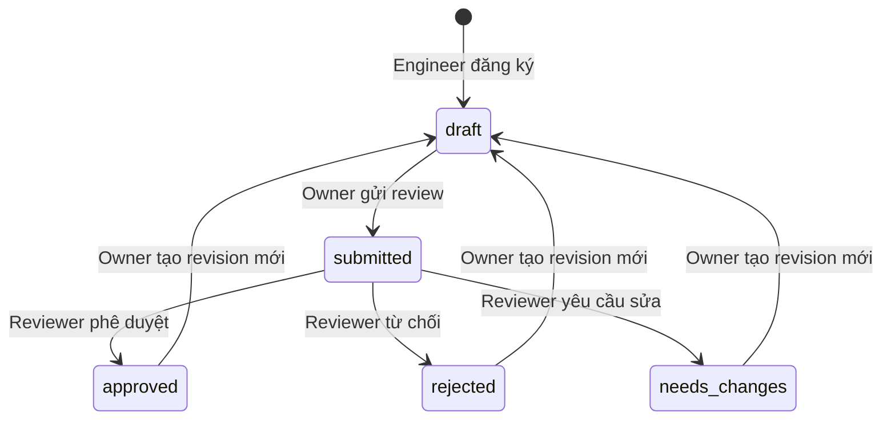

# Đăng nhập, phân quyền và review bộ artifact

**Mốc evaluation:** xem [WEB_EVALUATION_REVIEW.md](WEB_EVALUATION_REVIEW.md).
Manifest v1/approval bốn artifact giữ nguyên. Evaluation được ghép trên viewer
và chỉ nằm trong export khi revision manifest v2 tương ứng được duyệt. Các mô tả
ZIP sáu file và metric null bên dưới nói về snapshot v1.

Mốc này bổ sung vào [web viewer](WEB_VIEWER.md), theo [PROJECT_SPEC.md](../PROJECT_SPEC.md).
Ứng dụng vẫn phát lại prediction đã lưu; đăng nhập, review và export không chạy
mô hình. Bốn file inference gốc không bị thêm nhãn review hoặc ghi đè.

## Chạy local và tạo tài khoản

Dùng cùng môi trường `.venv-web`, Node và lockfile đã có trong hướng dẫn viewer.
Tính năng mới dùng `sqlite3`, `hashlib.scrypt`, `secrets`, `hmac` và `zipfile`
của thư viện chuẩn Python; không cần cài thêm dependency vào web hoặc `rav25`.

Tại gốc repo, tạo tài khoản bằng CLI. Mật khẩu được nhập ẩn, tối thiểu 12 và tối
đa 1024 ký tự; không truyền mật khẩu trong tham số dòng lệnh:

```bash
cd '/mnt/d/New folder/OCCFusion'
.venv-web/bin/python tools/create_viewer_user.py --username engineer --role engineer
.venv-web/bin/python tools/create_viewer_user.py --username reviewer --role reviewer
```

Username được chuẩn hóa thành chữ thường, dài 3–64 ký tự ASCII gồm chữ, số,
`._-`. Không có tài khoản/mật khẩu mặc định, không có API tự đăng ký hay tự đổi
vai trò. CLI quản trị local là nơi cấp vai trò. `--password-stdin` dành cho công
cụ tự động truyền bí mật qua stdin; không viết mật khẩu thực vào script/Git.

Build và chạy:

```bash
export PATH="$PWD/.cache/toolchains/node/bin:$PATH"
cd web/frontend
NEXT_TELEMETRY_DISABLED=1 npm run build
cd ../..
bash tools/run_web_viewer.sh
```

Mở **http://localhost:3000**. Đăng nhập Engineer, chọn run success và làm quy
trình bên dưới. Một phiên trình duyệt khác hoặc sau khi đăng xuất có thể đăng
nhập Reviewer. Nếu workspace chưa có tài khoản, màn hình đăng nhập hướng dẫn
CLI; server đang chạy nhận tài khoản mới ngay, không cần restart để cấp account.

## SQLite và phiên đăng nhập

Mặc định dữ liệu tài khoản/review nằm tại:

```text
work/viewer/viewer.sqlite3
work/viewer/manifests/<run_id>/<fingerprint_sha256>.json
```

`state_root` trong `web/viewer.config.json` hoặc `VIEWER_STATE_ROOT` chọn thư mục
khác. Đường dẫn tương đối tính từ file config. SQLite dùng WAL, foreign keys và
transaction `BEGIN IMMEDIATE` cho thao tác thay đổi workflow. Account, phiên
chưa hết hạn, các revision và lịch sử tồn tại sau khi restart. Khi sao lưu,
sao lưu nhất quán database cùng thư mục manifests; không xóa `work/viewer` nếu
muốn giữ tài khoản và lịch sử.

Mật khẩu được hash bằng scrypt `N=2^17, r=8, p=1`, salt ngẫu nhiên 32 byte và
derived key 64 byte; so sánh bằng `hmac.compare_digest`. Password plaintext không
được lưu trong SQLite. Session ID là giá trị ngẫu nhiên 256 bit; SQLite chỉ lưu
SHA-256 của token, không lưu token cookie nguyên bản.

Session hết hạn tuyệt đối theo server, mặc định **8 giờ**. Đăng xuất xóa session
trong DB và cookie; token cũ không còn dùng được. Có giới hạn 5 lần đăng nhập
thất bại trong một phút cho cặp username/địa chỉ client.

Cả cookie session và cookie CSRF đều **HttpOnly**, `SameSite=Strict`, host-only,
`Path=/`, có `Max-Age`. JavaScript lấy CSRF token qua JSON bootstrap cùng origin,
chỉ giữ trong bộ nhớ; không đọc cookie hoặc lưu token vào localStorage. Mọi
POST, kể cả login/logout, phải gửi `X-CSRF-Token`. Server kiểm tra HMAC token,
cookie/header trùng nhau và hash token gắn đúng phiên đăng nhập; đồng thời kiểm
tra Origin/Referer khi có, và chặn `Sec-Fetch-Site: cross-site`.

`cookie_secure=false` phục vụ HTTP localhost. Khi dùng HTTPS, đặt
`VIEWER_COOKIE_SECURE=true` và cấu hình `VIEWER_ALLOWED_ORIGINS`/`allowed_origins`
đúng origin HTTPS. Default origin chỉ là các địa chỉ loopback cổng 3000/8000;
không dùng CORS wildcard. Đây vẫn là triển khai local, chưa phải kiểm chứng
triển khai HTTPS qua reverse proxy.

## Quyền tại backend

| Thao tác | Engineer | Reviewer |
| --- | --- | --- |
| Xem danh sách/kết quả local | Có | Chỉ revision hiện tại đã được gửi review |
| Đăng ký run success | Có, trở thành owner | Không |
| Ghi chú | Run do mình đăng ký | Run được phép xem |
| Gửi draft đi review | Owner của run | Không |
| Phê duyệt/từ chối/yêu cầu sửa | Không, API trả 403 | Có, chỉ khi `submitted` và hash còn khớp |
| Tạo revision draft mới | Owner, khi revision không đang `submitted` | Không |
| Xuất gói hạ nguồn | Chỉ khi approved và hash khớp | Tương tự, trong phạm vi run được xem |

Các route list/detail, occupancy, LiDAR, BEV và workflow đều cần đăng nhập.
Chỉ health, bootstrap session và login được gọi trước khi đăng nhập; chúng
không trả prediction. Giao diện ẩn thao tác không có quyền, nhưng quyết định
phân quyền nằm ở backend, không dựa vào role do client gửi.

## Quy trình và lịch sử



Mỗi lần đăng ký/tạo revision, gửi và quyết định review phải có nhận xét không
rỗng, tối đa 4000 ký tự. Notes và export cũng có sự kiện riêng. Lịch sử lưu
actor ID, username/role tại thời điểm thao tác, thời gian UTC, revision, trạng
thái trước/sau, nội dung và fingerprint. UI trình bày thời gian theo Việt Nam.
Không có API sửa/xóa sự kiện cũ.

Sau `needs_changes` hoặc `rejected`, Engineer ghi lý do và tạo revision nháp
mới, rồi gửi lại. Revision mới có thể dùng cùng bộ file hoặc bộ file đã sửa;
vẫn cần một quyết định review mới. Reviewer không thấy draft mới cho đến khi
Engineer gửi revision đó. Một revision đang `submitted` không được thay bằng
draft trong lúc chờ quyết định. ID revision và fingerprint trong request chặn
thao tác từ màn hình đã lỗi thời; quyết định lặp hoặc trạng thái sai trả 409.

## Manifest và fingerprint

Khi đăng ký, backend đọc và kiểm tra bộ file thật, xác nhận token metadata/report
và dữ liệu nuScenes, rồi tạo manifest sidecar ngoài thư mục inference. Manifest
chứa:

- `schema_version`, `run_id`, `sample_token`.
- `sample_token_sources`: `metadata.json:sample_token`, `report.json:sample_token`.
- `npz_contains_sample_token: false`; không giả định token nằm trong NPZ.
- `artifacts`: SHA-256 và số byte của `occupancy.npz`, `metadata.json`,
  `report.json`, `bev.png`.
- `fingerprint_sha256`: SHA-256 của JSON core đã canonicalize, chưa có chính
  trường fingerprint. JSON core dùng sort key, UTF-8, không khoảng trắng phân
  cách (`separators=(',', ':')`, `ensure_ascii=False`).

Mỗi revision lưu fingerprint và bản manifest trong DB; file sidecar theo tên
fingerprint được kiểm tra với bản DB. Submit, quyết định review và export đọc
lại byte và tính SHA-256, không tin cache theo mtime/size. Vì vậy sửa file nhưng
giữ nguyên mtime và size vẫn bị phát hiện. Thay sidecar cũng chặn approval/export.

Nếu artifact đổi, lịch sử approval cũ vẫn được giữ cho fingerprint cũ, nhưng
`approval_valid=false`, UI báo rõ và không cho export bộ mới. Owner tạo revision
mới để gửi lại. Nếu khôi phục chính xác toàn bộ byte đã được duyệt, fingerprint
lại là bộ cũ; một revision draft mới vẫn phải được duyệt trước khi xuất.

Manifest không phải chữ ký số của tổ chức: nó liên kết nội dung chính xác với
quyết định trong database local. Việc giữ database/manifests tin cậy thuộc quyền
quản trị filesystem của workspace.

## Export được kiểm tra hash

`POST /api/runs/{run_id}/export` yêu cầu phiên hợp lệ và CSRF. Chỉ revision hiện
tại ở trạng thái `approved` với bốn hash và sidecar còn khớp mới trả ZIP:

```text
occupancy.npz
metadata.json
report.json
bev.png
manifest.json
review.json
```

Bốn file đầu được đóng gói nguyên byte. `review.json` chứa revision, fingerprint,
người/thời gian duyệt, người/thời gian xuất, lịch sử và metric từ report. Nội
dung ZIP lấy trực tiếp từ snapshot byte vừa được hash, không mở lại nguồn sau
khi kiểm tra. Transaction kiểm tra revision hiện tại và ghi sự kiện export.
Run draft/submitted/rejected/needs_changes hoặc bộ file khác fingerprint trả 409.

Approval không tạo metric GT: IoU/mIoU còn `null` và hiển thị **Chưa có GT**.
Confidence vẫn chưa hiệu chuẩn; allocator vẫn là số liệu của lượt inference đã
lưu, không được gọi là VRAM vật lý đo độc lập.

## API mới

| Route | Chức năng |
| --- | --- |
| `GET /api/auth/session` | Bootstrap CSRF, trả user hoặc `null`, thời hạn và trạng thái setup |
| `POST /api/auth/login` | Đăng nhập, xoay token phiên/CSRF |
| `POST /api/auth/logout` | Hủy phiên trong DB/cookie |
| `POST /api/runs/{id}/register` | Engineer đăng ký snapshot, tạo draft |
| `GET /api/runs/{id}/review` | Trạng thái, quyền, manifest, integrity và toàn bộ lịch sử |
| `POST /api/runs/{id}/review/notes` | Ghi chú append-only |
| `POST /api/runs/{id}/review/submit` | Owner gửi draft |
| `POST /api/runs/{id}/review/decision` | Reviewer chọn approved/rejected/needs_changes |
| `POST /api/runs/{id}/review/revise` | Owner tạo revision nháp mới |
| `POST /api/runs/{id}/export` | ZIP chỉ sau approval/hash verification |

Các body ghi chú dùng `comment`; submit/decision còn có `revision_id`,
`fingerprint`; decision thêm `decision`. Field lạ bị từ chối. Không có endpoint
nhận đường dẫn file tùy ý hoặc ghi vào bốn artifact inference.

## Kiểm thử local có dữ liệu thật

```bash
# Backend, tại gốc repo. Trong Codex cần ngoài sandbox cho ASGI như mốc trước.
.venv-web/bin/python -m pytest web/backend/tests -q \
  --junitxml=work_dirs/web_review_pytest.xml -o faulthandler_timeout=45

# QA Chromium + restart tiến trình backend thật, dùng cổng riêng.
.venv-web/bin/python tools/check_web_review.py
```

Công cụ QA tạo thư mục `work/review-qa-*/` riêng, sao chép artifact thật và hai
account QA có mật khẩu ngẫu nhiên chỉ giữ trong bộ nhớ/process environment.
Không seed account QA vào database production, không in mật khẩu. Backend QA
dùng 8001, Next.js QA dùng 3001 và `.next-qa`; viewer đang chạy ở 3000 không bị
công cụ QA dừng. Thư viện browser/SwiftShader dùng cùng cache như mốc trước.
Playwright không ghi trace để tránh lưu nội dung thao tác nhập credentials và
cookie. Ảnh chụp và báo cáo kết quả không chứa mật khẩu.

Thử sửa file chỉ diễn ra trên bản sao QA. Bộ kiểm tra xác nhận hash của bộ gốc
không đổi, kiểm tra nội dung ZIP, restart backend QA thật rồi kiểm tra lại account,
phiên và lịch sử. Artifact, DB, logs và export QA nằm trong thư mục ignored.

## Kết quả thực tế ngày 2026-11-13

Đã chạy bằng `.venv-web/bin/python` (Python 3.10.12), Node 24.22.3 và Chromium
headless/SwiftShader. Dữ liệu QA là bản sao nguyên byte của
`work_dirs/infer_mini_cuda_v2`; các quyết định QA không ghi vào database sử dụng
thật. Sample token: `39586f9d59004284a7114a68825e8eec`.

| Lệnh / trường hợp | Kết quả thực tế |
| --- | --- |
| `python -m pytest web/backend/tests -q --junitxml=work_dirs/web_review_pytest.xml -o faulthandler_timeout=45` | **33 passed**, 80.97 s; không skip |
| Chạy lại `web/backend/tests/test_auth_review.py` sau khi bổ sung CSRF session binding và kiểm tra bundle | **13 passed**, 55.13 s |
| `npm run typecheck` | Đạt |
| QA `npm run build` | Đạt, gồm TypeScript |
| `python tools/check_web_review.py` → Chromium | **7 passed**, 106.21 s; không skip/flaky |
| Chưa đăng nhập: list/detail/occupancy/LiDAR/BEV/review/export | HTTP **401**; trang chỉ hiện login |
| Thiếu/sai CSRF, origin ngoài allowlist, CSRF hợp lệ của session khác | HTTP **403** |
| Engineer gọi API quyết định approved | HTTP **403** |
| Reviewer xem draft/chưa gửi hoặc tự đăng ký run | HTTP **403** |
| Engineer đăng ký, ghi chú, submit; Reviewer approve và download qua UI | Đạt; UI đúng vai trò, không có page error |
| Export run chưa approved | HTTP **409** |
| Sửa từng artifact, giữ nguyên size/mtime | Approval không còn áp dụng; export **409** |
| Sửa file trước quyết định hoặc thay sidecar | Quyết định/export bị chặn |
| `needs_changes`, `rejected`, draft mới, request revision cũ | Đạt; revision cũ không được quyết định/gửi lại |
| Restart **tiến trình** backend QA | Account, session và **5/5** sự kiện lịch sử vẫn còn; export lại đạt |
| ZIP sau restart | Đủ 6 file; SHA-256 bốn artifact bằng nguồn; manifest đúng fingerprint |
| IoU/mIoU | JSON `null`; UI **Chưa có GT** |
| Replay sau đăng nhập | 44.856 voxel, 32.483 điểm LiDAR; XYZ WebGL khớp API, sai số lớn nhất 0 |
| Filter lớp/chiều cao, toggle LiDAR, reset camera | Đạt; không thêm request inference, backend vẫn `inference_enabled=false` |
| Bốn artifact inference gốc | SHA-256 trước/sau toàn bộ QA không đổi |
| `.venv-web/bin/python -m pip check`, `py_compile`, `bash -n tools/run_web_viewer.sh` | Đạt |
| Build production cuối và khởi động `bash tools/run_web_viewer.sh` | Đạt; frontend 3000, backend 8000 trên loopback |
| Chromium mở bản production `http://localhost:3000` | Login và hướng dẫn tạo account đầu tiên hiện đúng; không canvas prediction hoặc page error trước đăng nhập |
| Windows PowerShell `Invoke-WebRequest http://localhost:3000` | HTTP **200** |

Lượt build production trong sandbox báo `Could not parse output from
TypeScript's --showConfig`. Cùng lệnh `NEXT_TELEMETRY_DISABLED=1 npm run build`
chạy ngoài sandbox đã đạt; không cần đổi cấu hình hoặc bỏ kiểm tra TypeScript.
Viewer production được để chạy sau kiểm tra; PID launcher và log nằm tại
`work_dirs/web_viewer_server.pid` và `work_dirs/web_viewer_server.log`. Database
sử dụng thật chưa có account; tạo hai account bằng CLI ở đầu tài liệu. Đây là
bước người quản trị tự chọn mật khẩu, không có credentials mặc định.

Chromium ban đầu phát hiện nhập nhận xét mới khi request lưu note còn chạy có
thể bị xóa lúc request hoàn tất. UI đã khóa textarea trong thời gian lưu và test
chờ note xuất hiện trong **lịch sử**, sau đó đi hết luồng submit/approve/export.
Lượt 7 ca đạt ở trên chạy với bản đã sửa này.

Bằng chứng:

- [`web_review_pytest.xml`](../work_dirs/web_review_pytest.xml) và
  [`web_review_auth_pytest.xml`](../work_dirs/web_review_auth_pytest.xml).
- [`web_review_evidence.json`](../work_dirs/web_review_evidence.json): hash gốc,
  fingerprint, kết quả restart và đường dẫn QA chứa DB, sidecar, ZIP đã tải và
  `browser-workflow.json`.
- [`web_review_login.png`](../work_dirs/web_review_login.png),
  [`web_review_approved.png`](../work_dirs/web_review_approved.png).
- [`web_review_localhost.json`](../work_dirs/web_review_localhost.json) và
  [`web_review_local_login.png`](../work_dirs/web_review_local_login.png): bản
  production sau khi khởi động lại, gồm kiểm tra HTTP từ Windows.
- `web/frontend/test-results/browser-results.json`: kết quả 7 ca Chromium.

Chưa kiểm chứng triển khai HTTPS qua reverse proxy, tải đồng thời nhiều người
dùng, hoặc UI trên trình duyệt Windows có GPU thật. Browser QA dùng software
WebGL, không phải benchmark GPU. Cookie `Secure` đã kiểm tra bằng HTTPS
TestClient; chưa phải phép kiểm tra TLS qua browser. Không có phần bị chặn trong
luồng local đã kiểm thử; account sử dụng thật do người quản trị tự tạo bằng CLI.

## File của mốc này

| Nhóm | File |
| --- | --- |
| Auth, SQLite, workflow/export mới | `web/backend/app/auth.py`, `database.py`, `review.py` |
| API và cấu hình | `web/backend/app/main.py`, `config.py`, `web/viewer.config.json` |
| CLI account và QA thật | `tools/create_viewer_user.py`, `tools/check_web_review.py` |
| Backend tests | `web/backend/tests/auth_support.py`, `test_auth_review.py`, `test_viewer.py` |
| Login/review UI | `web/frontend/components/AuthGate.tsx`, `ReviewPanel.tsx`, `Viewer.tsx`, `web/frontend/app/page.tsx`, `globals.css` |
| API client, types, build QA riêng | `web/frontend/lib/api.ts`, `types.ts`, `web/frontend/next.config.mjs`, `tsconfig.json`; `next-env.d.ts` do Next.js sinh lại khi build |
| Chromium | `web/frontend/e2e/auth-helpers.ts`, `review.spec.ts`, `viewer.spec.ts`, `coordinates.spec.ts`, `web/frontend/playwright.config.ts` |
| Hướng dẫn và launcher | `docs/AUTH_REVIEW.md`, `docs/WEB_VIEWER.md`, `tools/run_web_viewer.sh`, `.gitignore` |

Không thêm dependency: lockfile Python/npm hiện có tiếp tục áp dụng. `.gitignore`
giữ các quy tắc cũ và bổ sung SQLite/WAL/SHM cùng `.next-qa`.

Tham khảo kỹ thuật:
[Python hashlib.scrypt](https://docs.python.org/3.10/library/hashlib.html#hashlib.scrypt),
[OWASP password storage](https://cheatsheetseries.owasp.org/cheatsheets/Password_Storage_Cheat_Sheet.html),
[OWASP CSRF](https://cheatsheetseries.owasp.org/cheatsheets/Cross-Site_Request_Forgery_Prevention_Cheat_Sheet.html).
